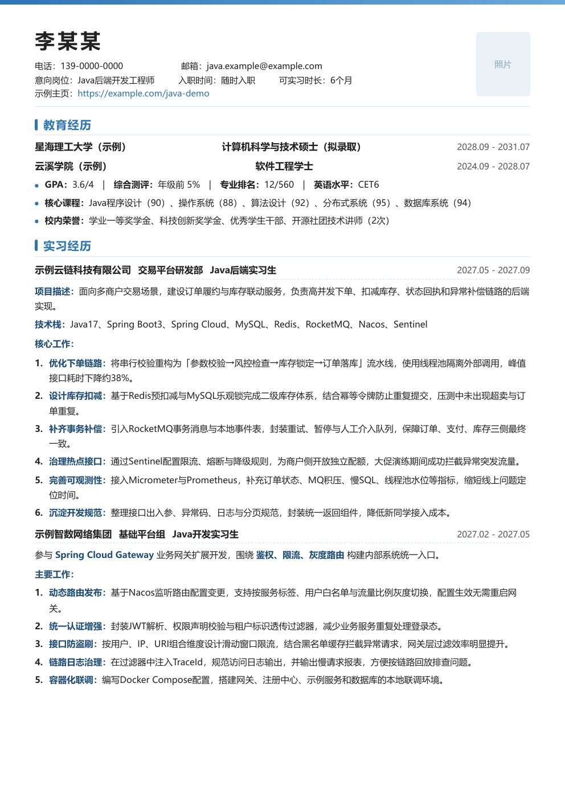
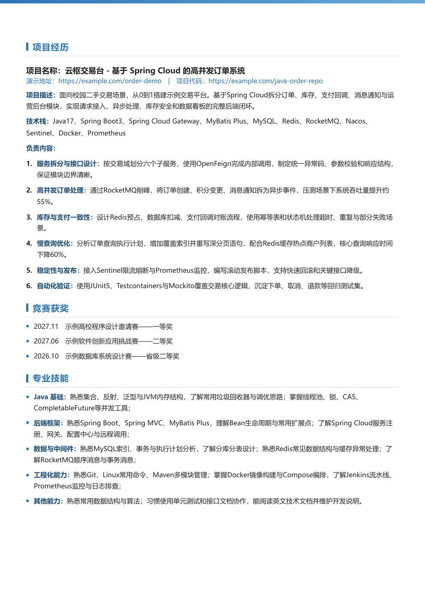

# 简历模板 Resume Template

一个简洁专业的中文简历 HTML 模板，支持直接导出为 A4 PDF。

## 特性
- 基于 HTML + CSS，无需依赖框架
- 适配 A4 打印尺寸，支持分页
- 现代化视觉设计，蓝色主题
- 完全匿名示例内容，可直接替换使用

## 效果预览

| 简历预览第一页 | 简历预览第二页 |
|:---:|:---:|
|  |  |

## 使用方法
1. 下载 `示例简历模板.html`
2. 用浏览器打开
3. 将示例内容替换为自己的信息，或使用 AI 工具自动修改
4. 使用浏览器打印功能导出 PDF

### 使用 AI 工具修改模板（推荐）

无需手动编写代码，你可以直接让 AI 编程助手帮你修改简历内容：

**Codex / DeepSeek Harness / Claude 等工具** 均可使用，示例提示词：

```text
请帮我修改简历模板文件 示例简历模板.html：
1. 将姓名「张三」改为「李四」
2. 将求职意向改为「算法工程师」
3. 将联系方式改为 139-0000-0000
4. 重新生成预览 PDF 和截图
```

AI 工具会自动完成内容替换、排版调整和 PDF 导出，无需手动编辑代码。

**推荐工具：**
- [Codex CLI](https://github.com/openai/codex) - OpenAI 官方命令行编程助手
- [DeepSeek Harness](https://github.com/deepseek-ai) - DeepSeek 编程助手
- [Claude Code](https://claude.ai/claude-code) - Anthropic 编程助手

使用这些工具时，只需将模板文件路径告诉它们，并描述想要修改的内容即可。

## 文件说明
- `示例简历模板.html`：模板源文件
- `preview.pdf`：两页示例 PDF 预览
- `assets/page-1.png`、`assets/page-2.png`：分页预览图
- `LICENSE`：开源许可协议

## 许可证
MIT License
